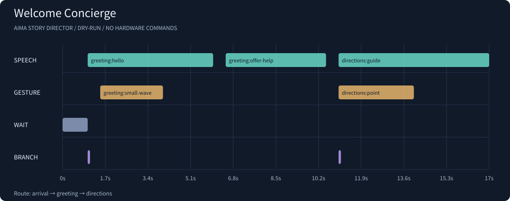

# AIMA Story Director · 机器人表演导演

把迎宾、导览和互动话术写成可检查的 JSON 场景，再离线排练每个动作和事件分支。运行一次即可得到时间线、SVG 排演图、台词文本和执行准备清单。

这是面向用户指定的 [AIMA 百大创作者计划 / 智元灵创平台](https://linkcraft.agibot.com/?activityPage=page2&locale=zh-CN&page=activity) 制作的独立项目。**当前交付是可运行的离线导演工具，未接入真机、未上传灵创平台，也未完成活动报名。**



## 直接运行

需要 Python 3.10 或以上；运行与测试均只使用标准库，无需安装依赖。

```bash
python3 -m aima_director validate examples/welcome.json
python3 -m aima_director simulate examples/welcome.json \
  --events examples/welcome.events.json --out output/welcome
python3 -m aima_director verify output/welcome/timeline.json
python3 -m unittest discover -s tests -v
```

在项目根目录执行。可选安装命令行入口：`python3 -m pip install -e .`，然后使用 `aima-director` 代替 `python3 -m aima_director`。

迎宾示例的实际运行结果：

```text
DRY-RUN: 迎宾：第一次见面的三十秒 | 17s | arrival -> greeting -> directions
8 simulated commands; hardware commands sent: 0
```

默认只进行 `dry-run`，不等待墙钟时间、不播放声音、不发送机器人命令。`--mode hardware` 会明确报错并以退出码 `2` 结束，不能切换成一个假装成功的硬件模式。

## 三个原创场景

| 场景 | 可以排练的决策 | 所附事件下的结果 |
| --- | --- | --- |
| [迎宾](examples/welcome.json) | 访客到达后欢迎；需要帮助时指引签到台 | 17 秒，8 条指令，[预览](demo/welcome/timeline.svg) |
| [展览导览](examples/exhibition.json) | 根据停留意愿选择深入讲解或简短总结 | 25 秒，8 条指令，[预览](demo/exhibition/timeline.svg) |
| [友好距离提醒](examples/distance-reminder.json) | 温和提醒后，恢复交流或交给现场工作人员 | 18.5 秒，7 条指令，[预览](demo/distance-reminder/timeline.svg) |

每个示例都有同名 `.events.json` 测试事件文件。距离提醒是**话术与流程排练**，没有测距传感器、避障、急停或碰撞预防能力。展览中的展品为原创虚构模型，不把模拟演示当作实际技术效果。

## 自动排练所有可行分支

```bash
python3 -m aima_director rehearse examples/distance-reminder.json --out output/rehearsal
```

以前一次模拟只能看到自己编写的事件快照。现在会按场景条件生成可行路线与代表性事件文件，包括事件缺失、显式布尔值，以及数字/字符串的非匹配值。重复判断同一事件时会保留前面的约束，能发现图上可到达、但整场固定事件不可能满足的分支，例如先要求 `visitor=true`，随后又要求同一个 `visitor=false`。

输出 `rehearsal.md` 分支覆盖表、带校验和的 `rehearsal.json`，以及每个 `case-NNN/` 的 `events.json`、时间线、SVG、台词和清单。可把生成的事件文件传回 `simulate --events` 重放；覆盖表区分 `covered`、`infeasible` 与 `unexplored`。只有完整探索后才会把未覆盖条件标为不可满足。

默认最多探索 64 条可行决策路径、执行 128 个代表性 case；另有场景展开和总指令上限。`--max-routes`、`--max-cases` 可分别调整至最多 256。触及上限会报告 **INCOMPLETE** 并退出 `3`，不会宣称全覆盖。这里的完整性仅针对本 DSL 的固定事件/相等比较语义及代表性用例，不等同于穷举实时事件流、所有数值或物理行为。所有排练仍为 dry-run，发送的硬件命令为 `0`。

## 场景 DSL

最小可执行脚本：

```json
{
  "schema_version": 1,
  "id": "hello-show",
  "title": "一声问候",
  "entry": "hello",
  "scenes": {
    "hello": {
      "label": "开场",
      "steps": [
        {"id": "say-hello", "type": "speech", "at_ms": 0, "duration_ms": 3000, "text": "您好，欢迎来到开放日。", "language": "zh-CN"},
        {"id": "wave", "type": "gesture", "at_ms": 500, "duration_ms": 1500, "name": "wave", "amplitude": 0.3, "speed": 0.25}
      ]
    }
  }
}
```

- `at_ms` 是当前场景内的绝对起始时间，单位毫秒；步骤需按开始时间排序。下个场景从上一场景的结束时间开始。
- `speech` 需要台词与预估时长；它不会调用 TTS，也不测算或保证真实语速。
- `gesture` 使用语义动作 `wave`、`nod`、`point-left`、`point-right`、`open-arms`、`stop-hand`、`neutral`。`amplitude` 为 `0..1`，`speed` 为 `>0..1`，仅是排演比例，**不代表任何机型的关节角度、速度或安全限值**。
- `wait` 以 `duration_ms` 保留等待区间；因为时间是显式编排的，它不会自动移动其他步骤。
- `branch` 必须是场景最后一步，且不能早于其他动作结束。其 `event`、`equals`、`then`、`else` 指定事件比较及目标场景。

例如先声明 `"events": {"visitor_present": "boolean"}`，然后使用：

```json
{"id": "choose", "type": "branch", "at_ms": 5000, "event": "visitor_present", "equals": true, "then": "greeting", "else": "standby"}
```

事件支持 `boolean`、`number`、`string`，类型严格匹配；布尔值 `true` 不会接受数字 `1` 代替。事件文件是整场排演固定的输入快照，不是实时事件流。缺失事件走 `else`，审计里会记录 `present: false`，与显式 `false` 区分。

## 校验与可审计输出

校验覆盖所有分支路径：拒绝未知字段、未声明事件、无效目标、循环、不可达场景、重复步骤 ID、乱序或负时间、同一语音或动作通道重叠、分支提前切断动作，以及超出范围的动作参数。语音与动作两个通道可以同时运行。单文件上限 2 MB，最多 128 个场景，每场景最多 256 个步骤；单场景最长 10 分钟，整条路线最长 30 分钟。

每次模拟生成：

| 文件 | 用途 |
| --- | --- |
| `timeline.json` | 场景路径、事件观测、每条命令的起止时间、参数、模拟回执与 SHA256 链 |
| `timeline.svg` | 可独立打开的四通道时间线；悬停可查看完整指令信息 |
| `transcript.txt` | 带时间标记的台词，便于审稿和配音准备 |
| `execution-checklist.md` | 实际部署前仍待完成的机型适配与执行准备事项 |

相同脚本和事件产生相同输出。`verify` 可以发现内容变化和链断裂。SHA256 校验是内容完整性检查，**不是数字签名，也不是真机执行证明**。预生成的 [demo](demo/) 目录可直接查看，并能按上述命令重新生成。

## 与真实机器人连接的边界

已核查官方 [AimDK 使用指南](https://open.agibot.com/docs/aimdk/a2/v1_2/getting_started/sdk_usage)、[交互二次开发指南](https://open.agibot.com/docs/aimdk/a2/v1_2/getting_started/interaction2) 及 [A3-Ultra 技能播放文档](https://open.agibot.com/docs/aimdk/a3-ultra/v3_3/dev_guide/07-10-skill_poilt)。这些协议按机型、固件版本和资源管理方式区分，不能据此假定存在统一的灵创上传或 AIMA 表演 API。

本项目没有硬件地址、设备凭据、SDK 资源、真实动作映射或现场操作权限，因此硬件执行明确未完成。下一步需要针对确认的设备实现并验证适配器；[适配契约](docs/adapter-contract.md) 列出本工具能提供的数据和仍需确认的内容。仓库中的语义动作不是官方动作资源 ID。

## 验证记录

本地测试含原有 15 项与新增 8 项分支排练测试：覆盖三个示例、条件相关导致的不可满足路径、事件缺失与显式 false、数字/字符串、相同目标的不同决策、探索上限、可重放导出、审计篡改和 CLI 非零退出。运行 `python3 scripts/check.py` 可重现测试并验证三个示例的完整导出流程。当前验证记录为本地运行结果。

[同类工具与开源比较](docs/landscape.md) 记录 Spot Choreographer、BehaviorTree.CPP 的既有能力、许可证边界、差距及本次独立实现的改进。时间线与分支行为的概念并非本项目首创。

MIT License。示例脚本、渲染图与实现代码均为本项目原创内容；本项目并非智元官方产品。

## Local demonstration, November 10

## 本地dry-run演示

[120秒双语静音演示](docs/media/aima-local-demo.mp4)把本次真实CLI运行的三份时间线与分支排练数据绘为说明图，并明确标注离线dry-run；[证据记录](docs/evidence/local-demo-20261110.json)保留命令、退出码、输出指纹及实际MP4解码帧。三个示例分别17秒/8条、25秒/8条、18.5秒/7条模拟指令，硬件命令均为0。它不是连续终端录像或机器人表演，不证明灵心/灵创原生作品发布、AimDK机型适配、传感器或现场安全能力。原创内容MIT，Codex辅助实现；运行时没有LLM、TTS或在线API调用。
